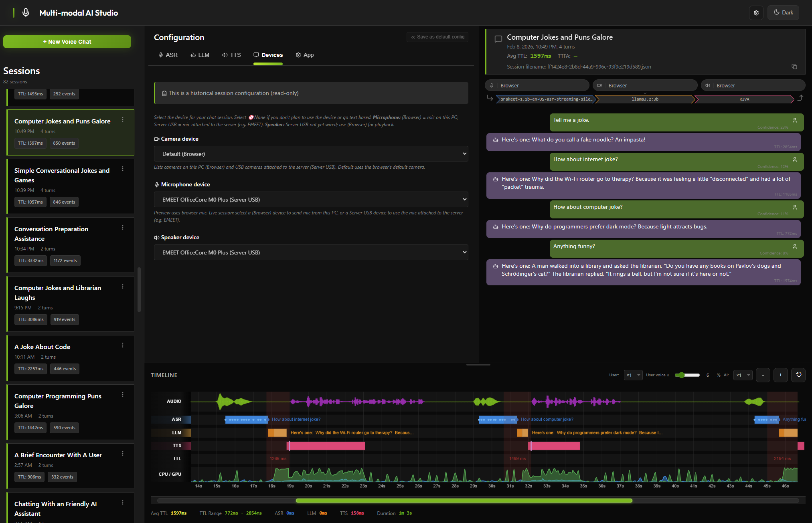
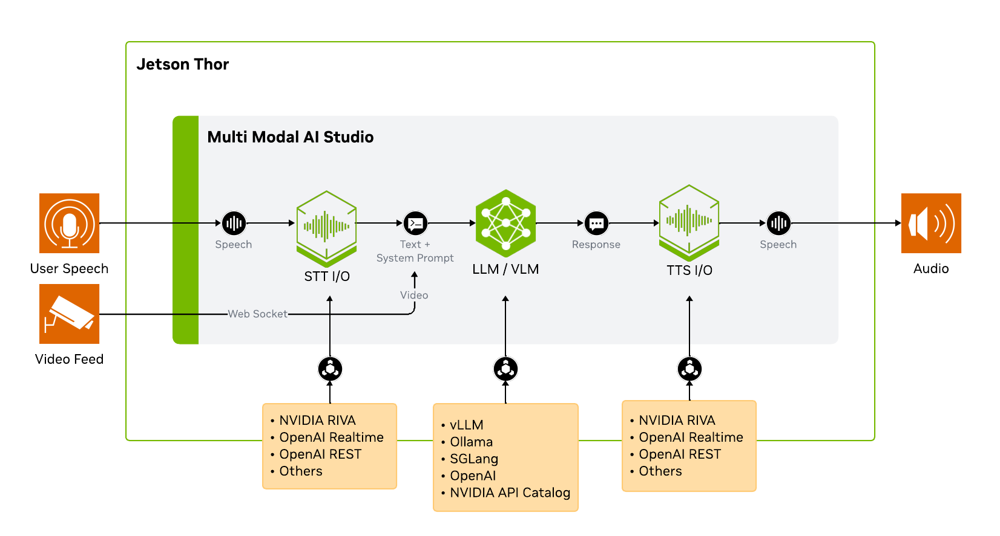

# Voice AI Workbench

**Give your robot a voice. Compare models, shape its character, and measure the conversation.**



Voice AI Workbench is a developer tool for building and tuning conversational AI. Connect independent speech recognition (ASR), language model (LLM), and text-to-speech (TTS) services; adjust the LLM system prompt; and compare recognition, response latency, playback, and interruptions on a shared timeline. Optional camera input lets you evaluate vision-language models too.

Start with your browser's microphone and speaker for a quick test. Then select a microphone and speaker attached to the Jetson, save the configuration, and evaluate the same conversation pipeline with server-local USB audio. Headless operation is experimental; this is a conversation workbench, not a robot motion-control framework.

Formerly **Multi-modal AI Studio (MMAS)**. Starting with 0.2.0, the distribution and recommended CLI are `voice-ai-workbench`. The GitHub repository, Python import `multi_modal_ai_studio`, existing settings/session formats, and legacy `multi-modal-ai-studio` CLI remain compatible. See the [upgrade instructions](https://github.com/NVIDIA-AI-IOT/multi_modal_ai_studio/blob/main/docs/development/releasing.md#upgrading-an-earlier-mmas-installation) before replacing an earlier MMAS wheel.

## What you can do

- **Compare speech services:** Speaches Faster-Whisper/Kokoro, NVIDIA Nemotron ASR/Magpie reference services, and NVIDIA Riva gRPC. REST and Realtime API support and streaming behavior depend on the provider.
- **Choose an independent LLM:** Connect an OpenAI-compatible Chat Completions endpoint from llama.cpp, vLLM, Ollama, or a hosted service. Change the system prompt to tune your assistant's character and responses.
- **Tune the conversation:** Discover models and voices, preview a voice, adjust speech speed where supported, and save reusable presets.
- **Inspect each turn:** View audio waveforms, VAD/ASR, LLM, TTS, barge-in, and CPU/GPU utilization alongside latency measurements. Save sessions with configuration/device snapshots and review or download the session JSON.
- **Choose your devices:** Use browser microphone/speaker over WebRTC, or Linux server-local USB audio. Camera/VLM support is optional and installed separately.

## Architecture



The workbench connects to model services; it does not bundle their weights or inference runtimes in the Python package.

## Quick Start

### 1. Install the application

Use **Python 3.11+** and a virtual environment. The commands below target 0.2.0; check [GitHub Releases](https://github.com/NVIDIA-AI-IOT/multi_modal_ai_studio/releases) for publication status. Before PyPI publication, install the verified candidate wheel instead of using the package-name command.

```bash
python3 -m venv .venv
source .venv/bin/activate
python -m pip install voice-ai-workbench==0.2.0
voice-ai-workbench --version
```

On Windows, activate with `.venv\Scripts\activate` instead. On Ubuntu, if virtual-environment creation fails because `venv` or `ensurepip` is missing, install `python3-venv` or the matching version package (for example, `python3.12-venv`).

The wheel includes the Web UI and built-in presets. To open the UI and inspect saved sessions without starting model services:

```bash
voice-ai-workbench --port 8092
```

Open `https://localhost:8092`, or `https://JETSON_IP:8092` from another computer. The default certificate is self-signed; verify that you are connecting to your device before accepting it. Microphone access requires HTTPS and browser permission. Stop the foreground application with **Ctrl+C** before restarting it with a preset.

### Recommended quick start on Jetson

The recommended conversation path is **Faster-Whisper tiny.en → Gemma 4 E2B → Kokoro**, using the **Speaches on Jetson — REST** preset. It has been exercised on Jetson Orin Nano and AGX Thor. No separate Ollama installation, Riva server setup, NGC entitlement, or hosted inference key is required.

The backend launch scripts are **repository tools, not part of the wheel**. After the release is published, obtain a matching checkout for those scripts; keep using the pip-installed application:

```bash
git clone --branch v0.2.0 --depth 1 \
  https://github.com/NVIDIA-AI-IOT/multi_modal_ai_studio.git
cd multi_modal_ai_studio

# Check the Jetson host, then start ASR/TTS and download the starter models.
./scripts/speaches_speech.sh doctor
./scripts/speaches_speech.sh start
./scripts/speaches_speech.sh verify

# Start text-only Gemma 4 E2B with the appropriate Orin or Thor container.
./scripts/gemma4_llm.sh start
./scripts/gemma4_llm.sh verify

# Start the installed application from outside the source checkout.
cd ..
voice-ai-workbench --preset speaches-jetson --port 8092
```

Docker, the NVIDIA container runtime, and a host GPU driver compatible with **CUDA 13 containers** are required for these launchers. Do not assume every JetPack release supports this image. See [Speaches on Jetson](https://github.com/NVIDIA-AI-IOT/multi_modal_ai_studio/blob/main/docs/setup_speaches_jetson.md) for prerequisites, model-cache storage, ports, memory considerations, and overrides.

The launcher pins **Speaches 0.9.0-rc.3**, a backend release candidate independent of the workbench's version. **Use REST for the public quick start:** the pinned image's Realtime ASR path has known concurrent-load failures on Nano. A corrected local backend passed follow-up tests but is not yet in that published image; installing this Python package alone does not apply that backend fix. See the [qualification record](https://github.com/NVIDIA-AI-IOT/multi_modal_ai_studio/blob/main/docs/releases/v0.2.0-qualification.md#realtime-concurrent-load-follow-up--november-5-2026).

### NVIDIA open speech models

To compare **Nemotron 3.5 ASR and Magpie TTS** without setting up a Riva server, run these commands from the matching repository checkout:

```bash
./scripts/nvidia_open_models_speech.sh build
./scripts/nvidia_open_models_speech.sh start
./scripts/nvidia_open_models_speech.sh verify
```

This launcher manages **only ASR and TTS**, not the LLM. Keep a separately managed OpenAI-compatible LLM running, then select **NVIDIA Speech — REST** or **NVIDIA Speech — Realtime** in the UI. See [NVIDIA open speech models on Jetson](https://github.com/NVIDIA-AI-IOT/multi_modal_ai_studio/blob/main/docs/setup_open_models_jetson.md) for exact models, requirements, and streaming limits. Existing Riva users can instead connect their gRPC server using the [Riva setup guide](https://github.com/NVIDIA-AI-IOT/multi_modal_ai_studio/blob/main/docs/setup_riva.md).

### Optional devices and vision

Install only the features you use:

```bash
python -m pip install 'voice-ai-workbench[audio]==0.2.0'         # PyAudio devices
python -m pip install 'voice-ai-workbench[camera]==0.2.0'        # server USB camera
python -m pip install 'voice-ai-workbench[video-input]==0.2.0'   # video files for VLMs
python -m pip install 'voice-ai-workbench[webrtc-camera]==0.2.0'
```

Linux ALSA USB audio uses `arecord`/`aplay` from `alsa-utils`; it does not require the PyAudio extra. PyAudio needs PortAudio system dependencies. See [installation and device setup](https://github.com/NVIDIA-AI-IOT/multi_modal_ai_studio/blob/main/INSTALL.md).

### Development installation

For source changes, use a separate environment and an editable install instead of the release wheel:

```bash
git clone https://github.com/NVIDIA-AI-IOT/multi_modal_ai_studio.git
cd multi_modal_ai_studio
python3 -m venv .venv
source .venv/bin/activate
python -m pip install -e .
```

Alternatively, `./scripts/setup_dev.sh` prepares a development environment. Sample sessions in `mock_sessions/` are available in the repository checkout; run with `--session-dir mock_sessions` to review them. New sessions are stored in `sessions/` relative to the working directory unless `--session-dir` is specified.

## Scope and limitations

- **Streaming depends on the backend.** A Realtime WebSocket API does not guarantee model-native incremental recognition or synthesis. Speaches Faster-Whisper uses VAD-delimited utterances and may not emit partial transcripts.
- **Early TTS uses text chunks.** “Start speaking before LLM finishes” can reduce waiting, but short chunks affect prosody and shared GPU load can cause playback gaps. Disable it for a baseline quality comparison.
- **Small devices need memory headroom.** Stop unrelated GPU services and start with the small preset. Cold model loading can delay the first response; swap does not increase GPU memory.
- **USB/headless validation is narrower than browser validation.** Speaker placement and hardware echo cancellation affect self-transcription and barge-in. Validate your own microphone/speaker setup before robot integration.
- **Use a trusted development network.** Do not expose the unauthenticated UI or model endpoints directly to the public internet. Functional tests do not substitute for dependency/security review.

## Documentation

| Guide | Description |
| --- | --- |
| [Installation](https://github.com/NVIDIA-AI-IOT/multi_modal_ai_studio/blob/main/INSTALL.md) | Package installation, devices, and troubleshooting |
| [Speaches on Jetson](https://github.com/NVIDIA-AI-IOT/multi_modal_ai_studio/blob/main/docs/setup_speaches_jetson.md) | Recommended Faster-Whisper + Gemma 4 E2B + Kokoro setup |
| [NVIDIA open speech models](https://github.com/NVIDIA-AI-IOT/multi_modal_ai_studio/blob/main/docs/setup_open_models_jetson.md) | Nemotron ASR + Magpie TTS reference services |
| [Speech API backends](https://github.com/NVIDIA-AI-IOT/multi_modal_ai_studio/blob/main/docs/api_backends.md) | REST, Realtime, and Riva contracts |
| [Realtime speech](https://github.com/NVIDIA-AI-IOT/multi_modal_ai_studio/blob/main/docs/realtime_speech.md) | Transcription and response-audio integration |
| [VLM guide](https://github.com/NVIDIA-AI-IOT/multi_modal_ai_studio/blob/main/docs/vlm_guide.md) | Vision-language models and frame capture |
| [Architecture](https://github.com/NVIDIA-AI-IOT/multi_modal_ai_studio/blob/main/docs/development/architecture.md) | System design and components |
| [0.2.0 release notes](https://github.com/NVIDIA-AI-IOT/multi_modal_ai_studio/blob/main/docs/releases/v0.2.0.md) | Changes, compatibility, and validation scope |

## Contributing

Issues, pull requests, and feedback are welcome. Start with the [repository](https://github.com/NVIDIA-AI-IOT/multi_modal_ai_studio) and describe your device, model services, preset, and reproduction steps.

## License

Apache License 2.0. See [LICENSE](https://github.com/NVIDIA-AI-IOT/multi_modal_ai_studio/blob/main/LICENSE). Model weights and backend containers have their own licenses and requirements.
