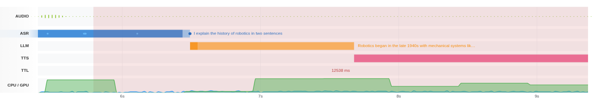
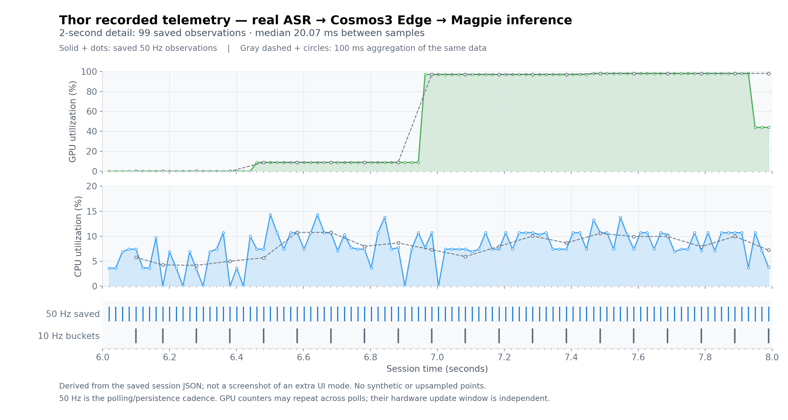

# CPU/GPU telemetry: detailed recording, lower-rate live display

The voice pipeline separates measurement/persistence from browser delivery.
This restores the earlier Orin-only 50 Hz experiment on current main and also
extends the persistent nvidia-smi path used on Thor.

| Path | Recorded CPU/GPU samples | Live delivery |
| --- | --- | --- |
| Orin sysfs load counter | Target 50 Hz, dedicated sampler thread | 10 Hz buckets |
| Thor/desktop persistent nvidia-smi | Target 50 Hz, one `--loop-ms=20` process | 10 Hz buckets |
| One-shot subprocess fallback | Existing 10 Hz CPU / up to 4 Hz GPU | 10 Hz; unknown GPU samples remain null |

Live buckets average CPU utilization and retain the maximum observed GPU
utilization. A final short bucket is flushed when a source ends. The session's
`system_stats` array retains the detailed observations with their actual
timestamps; WebSocket delivery does not append duplicate downsampled records.
Missing intervals are not filled with fabricated samples.

Recorded-session review already draws from `system_stats`. At low zoom, points
sharing a display pixel are collapsed with peak preservation. Zooming in can
expose the denser recorded grid without increasing live WebSocket traffic.
Existing 10 Hz recordings stay 10 Hz: more detail requires a new session.

## Polling cadence is not hardware measurement resolution

CPU utilization is an average between reads. GPU load values can also represent
a device/driver-defined averaging window and repeat across several polls.
NVIDIA documents nvidia-smi GPU utilization sample periods that vary by product
([nvidia-smi utilization documentation](https://docs.nvidia.com/deploy/nvidia-smi/index.html#utilization)).
A 20 ms polling target does **not** guarantee independent 20 ms GPU measurements
or that every very short ASR kernel will become visible. Async event-loop stalls
can delay Thor stream consumption; buffered bursts are coalesced with their GPU
peak rather than assigned invented 20 ms timestamps. The one-shot fallback
explicitly remains lower rate.

## Validation

Unit coverage includes the 20 ms process command, 50/10/fallback constants,
CPU mean and GPU peak aggregation, final partial buckets, unknown values,
and missed intervals without catch-up bursts. Existing replay peak-preserving
rendering and gap tests are retained.

On AGX Thor 128 GB / L4T R39.2.1 (2026-11-09), separate 15-second idle voice
transport sessions produced:

| Measurement | Released 10 Hz baseline | 50 Hz recording branch |
| --- | --- | --- |
| Recorded samples | 147 | 747 |
| Observed recording rate | 9.98 Hz | 49.83 Hz |
| Median / p95 sample interval | 100.12 / 101.90 ms | 20.07 / 20.11 ms |
| Live messages | 147 | 150 |
| Python server CPU, one-core basis | 0.87% | 1.60% |
| nvidia-smi CPU, one-core basis | 0.07% | 0.07% |
| Saved session JSON | 16,464 bytes | 63,742 bytes |

These are short diagnostic runs, not a controlled latency or power benchmark.
An independent CPU-only container build was active. No microphone input or
model inference was used in this idle comparison. Do not generalize the CPU
figures to Orin Nano, long sessions, or inference load without measuring those
conditions. The original Orin sysfs experiment is retained in its old worktree;
this PR does not include its unrelated footer CSS changes.

A separate Orin Nano Super / L4T R39.2.1 sampler-only check recorded 500 sysfs
samples over ten seconds: 50.00 Hz, median 20.00 ms, p95 20.01 ms, and 99 live
buckets. Sampler process CPU was 2.47% on a one-core basis. This checks the
sampling primitives, not a complete Orin voice/UI or USB regression.

The Python unit suite passed 235 tests (one existing skip), all 46 JavaScript
regressions passed, and Chromium reopened the Thor recording with all 747
saved observations and no page errors. Longer recordings use about five times
as many telemetry entries as before; JSON size, memory, and replay cost should
be considered for long-running robot deployments.

For manual verification: record a new conversation, stop, reopen it, zoom the
resource lane, and inspect adjacent `system_stats[].t` differences in the JSON.
Check that playback, barge-in, session review, and server-local USB capture still
work, and that closing the session leaves no nvidia-smi child process behind.

```bash
python scripts/inspect_session_telemetry.py sessions/SESSION_ID.json
```

## Screenshots under inference load

A new Chromium capture on November 9, 2026 feeds a fixed WAV through the
browser microphone path into Nemotron Realtime ASR, Cosmos3 Edge, and Magpie
Realtime TTS on Thor. Model inference and browser audio scheduling are real;
the microphone is a file-backed Chromium test device, not a physical device.
This is a telemetry/UI check, not an accuracy, latency, USB, or audibility
qualification. The VLM was text-only for this run.

The 36.9-second recording contains 1,842 detailed observations (49.73 Hz;
median 20.07 ms, p95 20.13 ms, maximum gap 66.23 ms). The browser received
369 live telemetry messages, reopened all saved observations, and reported
no page errors.

### Actual MMAS recorded-session timeline, zoomed 10×

The image is an unmodified canvas screenshot from recorded-session review.
It focuses on ASR finalization, LLM generation, and the start of TTS. The UI
smooths the area chart and fits the full 0–100% utilization scale into one
lane, so individual observations are easier to inspect in the data plot below.



### Two-second view of the saved observations

This is a separate diagnostic plot derived from the same session JSON, not
an additional UI mode. The 6.0–8.0 second window contains 99 actual saved
observations, with a median interval of 20.07 ms. Dots and bottom-row ticks
show the observations; no points are upsampled or invented. The dashed trace
illustrates 100 ms CPU-mean/GPU-peak aggregation of the same data (20 buckets),
not a separately timed 10 Hz benchmark or the exact phase of live delivery.

CPU variations are visible at the denser cadence. GPU counters often repeat
across adjacent polls; higher-rate persistence does not make them independent
20 ms hardware measurements.



The telemetry-only [window data](../images/telemetry-50hz/thor-inference-window-20261109.json)
is included for inspection. Historical and idle screenshots were removed from
this PR because they do not visually demonstrate the recording density.
